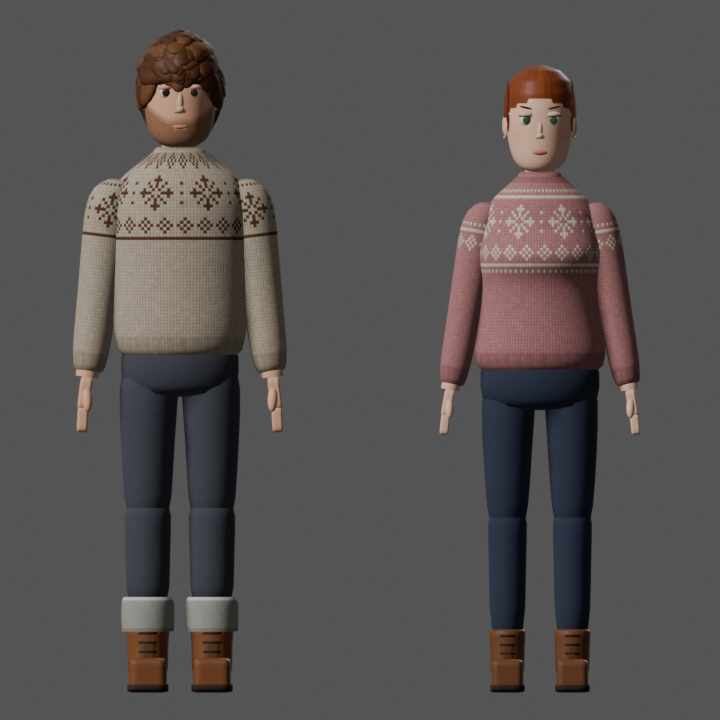
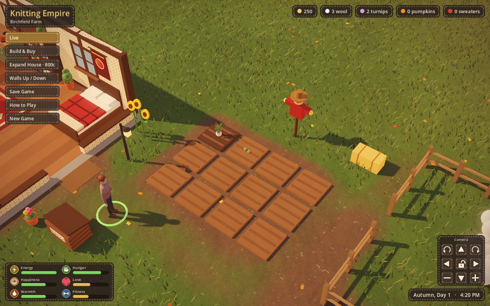

# Knitting Empire

A cozy life-sim prototype built in Godot 4. Raise sheep, knit sweaters, grow crops, decorate your house, make friends in the town of Maplewood and buy property to rent out.



## Play

1. Install [Godot 4.7+](https://godotengine.org/download) into `/Applications`.
2. Double-click `Play.command`, or run:

```bash
open -n -a /Applications/Godot.app --args --path .
```

Controls:
- Click the floor to walk.
- Click objects and people to see what you can do with them.
- WASD or the arrow keys pan the camera.
- Q and E rotate the camera, and the scroll wheel or a trackpad pinch zooms.
- Space or the lock button locks the camera to your character.
- C toggles the walls.
- B toggles Build mode. In Build mode, R rotates a piece, X sells it and Esc cancels.

## What's in it

- **Act 1: Cast On.** A new game opens on the story. Nora steps off the last bus into Maplewood in the rain, walks down the road to her late grandmother's farm, gets the keys from Mabel, finds Gran's knitting basket and a letter, and meets Rowan when three sheep get out. It takes about four to five minutes, with a few choices that set flags and relationship stats for later. Old saves skip it; start a **New Game** to see it. A recording of the whole opening is in [`docs/opening.mp4`](docs/opening.mp4).
- **Home and farm:** a house you can expand, furniture to place, sheep to shear, crops to plant, water and harvest, and a shipping bin.
- **Maplewood:**
  - three villagers (Rosa, Theo, Mabel) with friendship hearts, gifts and dialogue
  - daily market prices
  - a wool shop where you can also buy sheep
  - Rosewood Cottage, which you can buy, furnish and rent out
- **Characters:** Nora (the heroine you play, working name) and Rowan (the shepherd in Maplewood) come from one Blender script, `tools/build_character.py`. Each is one skinned mesh on the same 22-bone humanoid skeleton, named to match Godot's humanoid profile, and both share the same loops: Idle, Walk, SitKnit, SitIdle, Work and Talk. Knitting needles and a swatch appear while knitting.

## Project layout

| Path | What |
|---|---|
| `data/*.json` | game content: furniture, crops, prices, villagers, dialogue |
| `scripts/data.gd` | loads and cross-checks the data files |
| `scripts/main.gd` | world, input, camera, actions, building, autotest |
| `scripts/game_state.gd` | autoloaded save data, economy and story flags |
| `scripts/hud.gd` | HUD, menus, camera pad, dialogue |
| `scripts/town.gd`, `villager.gd`, `dialogue.gd` | Maplewood |
| `scripts/player.gd` | the character you play and her activity states |
| `scripts/body.gd` | a skinned character body; picks and cross-fades animation loops |
| `scripts/story.gd`, `story_player.gd` | reads and plays the plain-text story scenes in `data/scenes/` |
| `shaders/woolcore.gdshader` | the felt and knit look |
| `docs/woolcore/` | style frames (ignored by Godot) |
| `tools/build_character.py` | Blender character generator: builds `assets/<id>.glb` |

## Adding content without code

Prices, furniture, crops, villagers and their lines all live in `data/`. Edit the JSON and run the game.

- **A new price or limit:** change it in `economy.json`.
- **A new villager:** add an entry to `villagers.json`, then give them an intro, three tiers of lines and a loved-gift line in `dialogue.json`.
- **A new crop:** add it to `crops.json` and give it a sell price in `economy.json`.
- **Furniture:** add it to `furniture.json`. A new kind of furniture still needs a builder in `catalog.gd`.

The autotest checks the files against each other and names anything missing.

Story progress is kept as named flags (`Game.set_flag("met_rowan")`, `Game.flag("met_rowan")`) and saved with the game. Save files carry a version number. When the format changes, add a step to `Game.migrate()` so older saves still load.

When exporting, add `data/*` to the export preset's non-resource include filter, so the JSON and scene files ship with the game.

## Writing story scenes

Scenes are plain text in `data/scenes/*.scene`. The full format is described at the top of `scripts/story.gd`. Here's a short example:

```
== rowan_town_chat
@trigger talk rowan
@once
@camera rowan 6
Rowan (wry): You've got hay on your sweater and a city coat over it.
? What do you say?
- I'm still figuring out which end of a sheep is which. -> honest | trust rowan +2
- I'll manage. I always do. -> guarded | set nora_guarded
@label honest
Rowan (happy): The end that bites is the front. Mostly.
@goto done
@label guarded
Rowan (neutral): Fair enough.
@label done
@set met_rowan
```

- A line is `Speaker (mood): text`. The mood picks a portrait from `assets/portraits/<id>_<mood>.png`: neutral, happy, warm, sad, wry, surprised, worried or angry.
- `> text` is narration.
- `?` starts a choice, followed by `- option -> label | effects`.
- Other commands move the camera, fade, show title cards, walk and animate characters, set flags, and change relationship stats.
- Staging commands set the goal shown at the top of the screen (with a marker on the map), make it rain, put down props like a bus or a suitcase, ring the phone, shake the camera, let the sheep out, and park a villager somewhere until a later scene sends them home.
- A scene plays when you talk to someone (`@trigger talk rowan`), on a new game (`@trigger start`), when you walk into a named place from `data/areas.json` (`@trigger area farm_gate`), or after an event such as finishing a knit (`@trigger event knit_done`).
- Act 1 is in `data/scenes/act1.scene`, which is a good worked example.
- Relationships have three stats: **familiarity** (shown as hearts), **trust** and **romance**.
- The autotest checks every scene file, so a typo or a jump to a missing label shows up as a failed check.

## Woolcore style (v0)

The world is meant to look handmade: felt and knitting.



- **Shader:** `shaders/woolcore.gdshader`. Every solid surface is felt, with soft mottling, fine fibres and a fuzzy rim. The grass, the house walls, rugs and plaid fabrics are knitted in stockinette stitches. Textures are projected in world space, so stitches stay the same size on any shape.
- **Which surfaces are knitted:** the `KNIT` list in `scripts/catalog.gd` (a colour and a stitch width). Glass, water and glowing things stay plain. Set `Catalog.woolcore = false` to compare with the old look.
- **Grade:** plum-tinted shadows, warm cream highlights and a little extra contrast (`_setup_environment` in `main.gd`), plus a soft vignette. Rain greys it down.
- **UI:** bordered panels and buttons are felt patches with a running stitch sewn round the edge, drawn in code (`_stitched` in `hud.gd`), so there are no image files to keep in sync.

To record the opening again (the game plays Act 1 by itself at reading pace, then quits; `ffmpeg` turns the AVI into an MP4):

```bash
/Applications/Godot.app/Contents/MacOS/Godot --path "$PWD" --resolution 1280x800 --write-movie /tmp/opening.avi --fixed-fps 30 -- --capture
```

The three style frames in `docs/woolcore/` are made by the game itself:

```bash
/Applications/Godot.app/Contents/MacOS/Godot --path "$PWD" --resolution 1280x800 -- --styleframes="$PWD/docs/woolcore"
```

## Characters

`tools/build_character.py` holds a spec for each character: body proportions (height, shoulders, waist, hips, bust, limbs, head), face, hair style, palette and outfit. Every character gets the same skeleton and the same animations, so a loop added once works for everyone. To add a character, add a spec and rebuild, list it in `data/characters.json`, and give a villager `"look": {"model": "<id>"}` in `data/villagers.json`.

Rebuild every character, and render turntables, pose sheets and a lineup:

```bash
/Applications/Blender.app/Contents/MacOS/Blender -b -P tools/build_character.py -- "$PWD" --character all --render /tmp/character_render --poses
```

Run the automated smoke test, which writes screenshots and prints PASS/FAIL lines:

```bash
/Applications/Godot.app/Contents/MacOS/Godot --path . -- --autotest=/tmp/ke_shots
```
