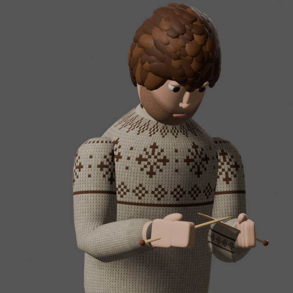

# Knitting Empire

A cozy life-sim prototype built in Godot 4. Raise sheep, knit sweaters, grow crops, decorate your house, make friends in the town of Maplewood and buy property to rent out.



## Play

1. Install [Godot 4.7+](https://godotengine.org/download) into `/Applications`.
2. Double-click `Play.command`, or run:

```bash
open -n -a /Applications/Godot.app --args --path .
```

Controls:
- Click the floor to walk.
- Click objects and people to see what you can do with them.
- WASD or the arrow keys pan the camera.
- Q and E rotate the camera, and the scroll wheel or a trackpad pinch zooms.
- Space or the lock button locks the camera to the farmer.
- C toggles the walls.
- B toggles Build mode. In Build mode, R rotates a piece, X sells it and Esc cancels.

## What's in it

- **Home and farm:** a house you can expand, furniture to place, sheep to shear, crops to plant, water and harvest, and a shipping bin.
- **Maplewood:**
  - three villagers (Rosa, Theo, Mabel) with friendship hearts, gifts and dialogue
  - daily market prices
  - a wool shop where you can also buy sheep
  - Rosewood Cottage, which you can buy, furnish and rent out
- **The farmer:** modelled, rigged and animated in Blender by `tools/build_farmer.py`. He's one skinned mesh on a humanoid skeleton named to match Godot's humanoid profile, with loops for Idle, Walk, SitKnit, SitIdle, Work and Talk, plus knitting needles and a swatch that appear while he knits.

## Project layout

| Path | What |
|---|---|
| `scripts/main.gd` | world, input, camera, actions, building, autotest |
| `scripts/game_state.gd` | autoloaded save data and economy |
| `scripts/hud.gd` | HUD, menus, camera pad, dialogue |
| `scripts/town.gd`, `villager.gd`, `dialogue.gd` | Maplewood |
| `scripts/player.gd` | the farmer and his animation states |
| `tools/build_farmer.py` | Blender script that builds `assets/farmer.glb` |

Rebuild the character:

```bash
/Applications/Blender.app/Contents/MacOS/Blender -b -P tools/build_farmer.py -- "$PWD" --render /tmp/farmer_render --poses
```

Run the automated smoke test, which writes screenshots and prints PASS/FAIL lines:

```bash
/Applications/Godot.app/Contents/MacOS/Godot --path . -- --autotest=/tmp/ke_shots
```
