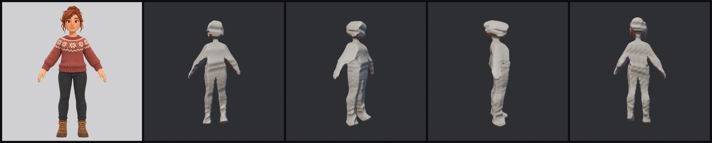
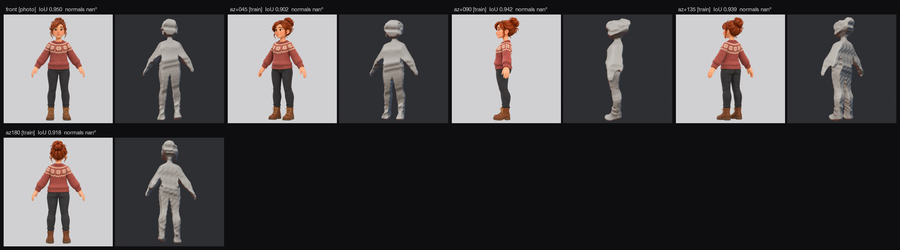

# image-to-sculpt report: stylized cozy-game young woman in a knitted Fair Isle sweater, jeans and boots

Input `input/nora_000_front.png` (1526×1526, kind auto), sha256 `01ddf1f0b04d1712…`. Working size 1024×1024 (padded to 1:1).

Front camera: focal 1407 px, mask from alpha, depth from none (assumed vertical fov 40.0 deg). Units: the subject's larger front extent = 1.

## Build

25 recorded steps: 7 carve, 1 remesh, 14 fit, 1 cut, 1 smooth, 1 finish. Every step is a mesh in `build/steps/`, replayed in Blender (`blender/sculpt.blend`) and shown in `timelapse.mp4`.

Symmetry: mirror IoU of the hull 0.729 at yaw 7.5° → not used.

## Views

| view | role | asked az / el | registered az / el | IoU vs hull | source |
|---|---|---|---|---|---|
| az+045 | train | 45 / 0 | 17.2 / 7.8 | 0.871 | import nora_views/az+045.png |
| az+090 | train | 90 / 0 | 100.8 / 11.5 | 0.862 | import nora_views/az+090.png |
| az+135 | train | 135 / 0 | 139.5 / 3.5 | 0.914 | import nora_views/az+135.png |
| az180 | train | 180 / 0 | 176.5 / -1.2 | 0.898 | import nora_views/az180.png |

## Measured

Same cameras for both rows. *train* = mean over the views used to fit (photo included); *held-out* = the view never used to fit, camera frozen before fitting; *best-fit* = the held-out view re-registered to the final shape.

| | IoU | outline px | normals median ° | normals < 15° | roughness × | photo depth /1000 |
|---|---|---|---|---|---|---|
| hull · train | 0.892 | 5.4 | – | –% | – | – |
| final · train | 0.925 | 5.2 | – | –% | – | – |

## Acceptance

Targets from `acceptance.json`, set before fitting and never relaxed.

| check | target | measured | |
|---|---|---|---|
| photo iou | >= 0.97 | 0.950 | **fail** |
| photo sil_px | <= 2.5 | 3.255 | **fail** |
| train_mean iou | >= 0.92 | 0.925 | pass |

## fal calls

0 calls, estimated $0.00 (request ids in `case.json`).

## What this is and is not

- The photo fixes what the camera sees: silhouette, normals, metric depth. Everything the photo does not see comes from generated views, which are the generator's guesses, made consistent by registration and screening. The held-out view is generated too: it measures consistency, not truth.
- The sculpt is a watertight mesh fitted in numpy (normal integration on a signed distance grid); Blender replays and renders the recorded steps and holds the final file.
